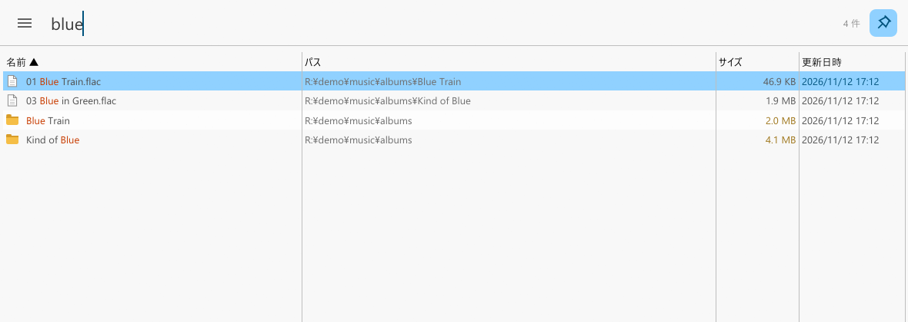

<p align="center">
  
</p>

<h1 align="center">accio</h1>

<p align="center">
  Windows 向けの即時ファイル検索。<a href="https://www.voidtools.com/">Everything</a> の完全上位互換を目指す。<br/>
  NTFS の MFT を直接読み、USN ジャーナルで変更を追い、UI は決して止まらない。
</p>

<p align="center">
  <a href="README.md">English</a> | <b>日本語</b>
</p>

<p align="center">
  <a href="docs/usage.md">使い方</a> · <a href="docs/development.md">開発</a> · <a href="https://github.com/kuguma/accio/releases">リリース</a>
</p>



## なぜ作るのか

Everything は Windows で最速のファイル検索ですが、大きなボリュームではフリーズや起動の遅さに悩まされます。accio は Everything の良さ（即時のインクリメンタル検索、検索構文、他のツールが依存する IPC/HTTP/ETP）をそのまま残し、残りを直します。

- **固まらない。** 索引構築・ジャーナル反映・保存・検索はすべてワーカースレッドで動き、UI はスナップショットを描くだけで索引のロックを待ちません。
- **構築中も検索できる。** 到着したボリュームから順に結果が出ます。1,700 万レコードのボリュームの初回スキャンが約 13 秒、保存済み索引の読み込みは約 1 秒。
- **Everything 互換。** 検索構文（修飾子・関数・マクロ・日付・サイズ・`dupe:`・`content:`・`type:` …）、IPC v1/v2（`es.exe` がそのまま使える）、IPC v3（SDK 3 の名前付きパイプ）、HTTP サーバー、ETP/FTP サーバー、`es:` URL プロトコル、EFU ファイルリスト。
- **Everything を越える。** 容量ビュー（大きいフォルダ/ファイル）、ReFS / Dev Drive、初回スキャン中の検索、権限分離インデクサ、ダイアクリティカルマークの折り畳み、件数上限なしのソート。

## インストール

[最新リリース](https://github.com/kuguma/accio/releases)から `accio.exe` をダウンロードして実行します。初回起動時に昇格（UAC）を求めます（MFT と USN ジャーナルの読み取りに管理者権限が要るため）。固定ディスクの NTFS/ReFS ボリュームを一度スキャンしたあとはトレイに常駐します。設定と索引は `%LOCALAPPDATA%\accio` に置かれます。

UI を昇格させたくない場合は、設定の「昇格インデクサ」を有効にしてください。ウィンドウなしの `accio -indexer` が索引を保守し、非昇格の UI がそれを追従します。

## ソースからビルド

```
cargo build --release -p accio
```

Windows 上の Rust ツールチェーンが必要です。`cargo test` は管理者権限なしで全テストを通せます（小さな NTFS テストイメージを使います）。

## 機能

| 領域 | 内容 |
|---|---|
| 検索 | インクリメンタル検索、Everything 1.4 構文、正規表現、大小/パス/単語/ダイアクリティカルの区別、フィルタとカスタムフィルタのマクロ、ドライブ選択、ブックマーク |
| 結果 | 名前/パス/サイズ/日時/拡張子/属性/種類/実行回数の列、どの列でも件数上限なしのソート、ハイライト、サムネイル、プレビュー、タブ、複数選択 |
| ファイル操作 | 開く、パスを開く、コピー、パスのコピー、名前の変更、一括リネーム、ごみ箱、Explorer のコンテキストメニュー、ドラッグ＆ドロップ、プロパティ、管理者として実行 |
| 索引 | NTFS の MFT スキャン＋USN ジャーナル、ReFS（ディレクトリ列挙＋USN V3）、任意フォルダ/UNC のフォルダ索引と変更監視、除外と対象限定、ハードリンク、フォルダサイズ |
| 連携 | IPC v1/v2/v3、HTTP サーバー（JSON/HTML、Basic 認証）、ETP/FTP サーバー、`es:` URL プロトコル、Explorer のフォルダ右クリック、EFU の書き出しとファイルリスト |
| アプリ | トレイ（ダブルクリックで表示）、グローバルホットキー、自動起動、セッション復元、日英 UI とドキュメント、配色（システム/ライト/ダーク）、フォントと色 |

キー操作・検索構文・コマンドライン・`accio.ini` の全キーは [docs/usage.md](docs/usage.md) にあります。

## 状況

accio は 0.x です。UI は日本語と英語に対応しています（Windows の表示言語に従い、`accio.ini` の `lang=` か設定画面で切り替え）。0.x の間は索引形式の互換性を保ちません（索引は作り直されるだけです）。

## ライセンス

MIT（[LICENSE](LICENSE)）。`testdata/` の NTFS テストイメージは [ntfs](https://github.com/ColinFinck/ntfs) クレート（MIT / Apache-2.0）由来です（[NOTICE](NOTICE)）。
