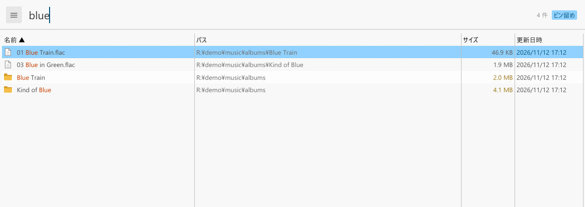
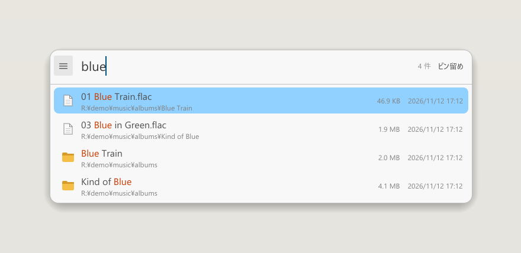

<p align="center">
  
</p>

<h1 align="center">accio</h1>

<p align="center">
  Instant file search for Windows, built as a full superset of <a href="https://www.voidtools.com/">Everything</a>.<br/>
  Reads the NTFS MFT directly, tracks changes through the USN journal, never blocks the UI.
</p>

<p align="center">
  <b>English</b> | <a href="README.ja.md">日本語</a>
</p>

<p align="center">
  <a href="docs/usage.en.md">Usage</a> · <a href="docs/development.md">Development</a> · <a href="https://github.com/kuguma/accio/releases">Releases</a>
</p>



<p align="center"></p>

<p align="center"><sub>Pinned (top): a normal window that works as a file browser. Unpinned (bottom): a Spotlight-style panel that hides when you click elsewhere.</sub></p>

## Why

Everything is the fastest file search on Windows, but it can freeze and start slowly on large volumes. accio keeps everything that makes Everything good (instant incremental search, the full query syntax, the IPC/HTTP/ETP interfaces that other tools rely on) and fixes the rest:

- **Never freezes.** Indexing, journal replay, saving and searching run on worker threads. The UI only renders snapshots and never waits on an index lock.
- **Search while indexing.** Results appear as soon as volumes arrive; the first full scan of a 17M-record volume takes about 13 seconds, loading a saved index takes about a second.
- **Everything-compatible.** Query syntax (modifiers, functions, macros, dates, sizes, `dupe:`, `content:`, `type:` …), IPC v1/v2 (`es.exe` works out of the box), IPC v3 (SDK 3 named pipe), HTTP server, ETP/FTP server, `es:` URL protocol, EFU file lists.
- **More than Everything.** Disk-usage view (largest folders and files), ReFS / Dev Drive support, search during the initial scan, privilege-separated indexer, diacritics folding, unlimited sorting on any column.

## Performance

Measured on the author's machine against Everything 1.4.1.1024, both indexing the same six NTFS volumes (about 20 million files and folders; Ryzen 9 7950X, 128 GB RAM, NVMe SSDs and SATA HDDs, Windows 11). Both apps were queried the same way, with the official `es.exe -get-result-count` (its wall-clock, including about 40 ms of process start-up), best of 7 runs.

| | Everything 1.4 | accio 0.1 |
|---|---:|---:|
| Start → searchable (saved index, warm cache) | 6.4 s | 2.0 s |
| `report` | 92 ms | 45 ms |
| `windows update` | 100 ms | 61 ms |
| `ext:pdf` | 45 ms | 44 ms |
| `*.dll` | 53 ms | 84 ms |
| `regex:^lib.*\.a$` | 545 ms | 84 ms |
| `x` (2.7 M hits) | 91 ms | 113 ms |
| empty query (all 20 M entries) | 87 ms | 237 ms |

Everything is still faster on a few shapes of query (wildcard-only, single character, empty). The point of accio is not that every query is faster, but that the UI never waits: those numbers were measured through the IPC while the window stayed responsive, and every search runs on a worker thread so the window never waits for one.

## Install

Download `accio.exe` from the [latest release](https://github.com/kuguma/accio/releases) and run it. On first start accio asks for elevation (reading the MFT and the USN journal requires administrator rights), scans all fixed NTFS/ReFS volumes once, and then stays in the tray. Settings and indexes live in `%LOCALAPPDATA%\accio`.

If you do not want the UI to run elevated, enable the privilege-separated indexer in Settings: a headless `accio -indexer` keeps the index up to date and the non-elevated UI follows it.

## Build from source

```
cargo build --release -p accio
```

Requires a Rust toolchain on Windows. `cargo test` runs the whole suite without administrator rights (it uses a small NTFS test image).

## Features

| Area | What you get |
|---|---|
| Search | Incremental search, Everything 1.4 syntax, regex, match case / path / whole word / diacritics, filters and custom filter macros, drive selection, bookmarks |
| Results | Name / path / size / dates / extension / attributes / type / run count columns, sorting on any column at any size, highlighting, thumbnails, preview pane, tabs, multi-select |
| Files | Open, open path, copy, copy path, rename, bulk rename, recycle, Explorer context menu, drag and drop, properties, run as administrator |
| Index | NTFS MFT scan + USN journal, ReFS (directory enumeration + USN V3), folder indexes for any path or UNC share with change watching, exclusions and include-only, hard links, folder sizes |
| Integration | IPC v1/v2/v3, HTTP server (JSON/HTML, Basic auth), ETP/FTP server, `es:` URL protocol, Explorer folder context menu, EFU export and file lists |
| UI | Search bar and results only; every option lives in the hamburger menu. Pinned window or Spotlight-style floating panel (Ctrl+Shift+P), light/dark/system theme, fonts and colors |
| App | Tray icon with double-click to show, global hotkey, autostart, session restore, English/Japanese UI and docs |

See [docs/usage.en.md](docs/usage.en.md) for keyboard shortcuts, the query syntax, command-line options and every `accio.ini` key.

## Status

accio is at 0.x. The UI is available in English and Japanese (it follows the Windows display language; `lang=` in `accio.ini` or the settings window overrides it). Breaking changes to the index format happen between 0.x releases (the index is simply rebuilt).

## License

MIT. See [LICENSE](LICENSE). The NTFS test image in `testdata/` comes from the [ntfs](https://github.com/ColinFinck/ntfs) crate (MIT / Apache-2.0); see [NOTICE](NOTICE).

## Donation

accio would not exist without Everything. If you find accio useful, please consider [donating to Everything](https://www.voidtools.com/donate/) (voidtools).
